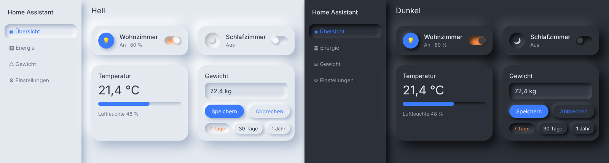
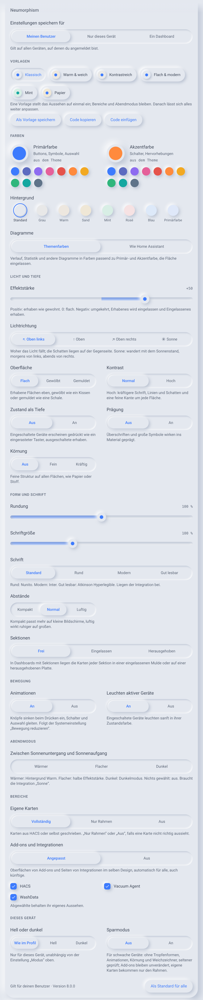
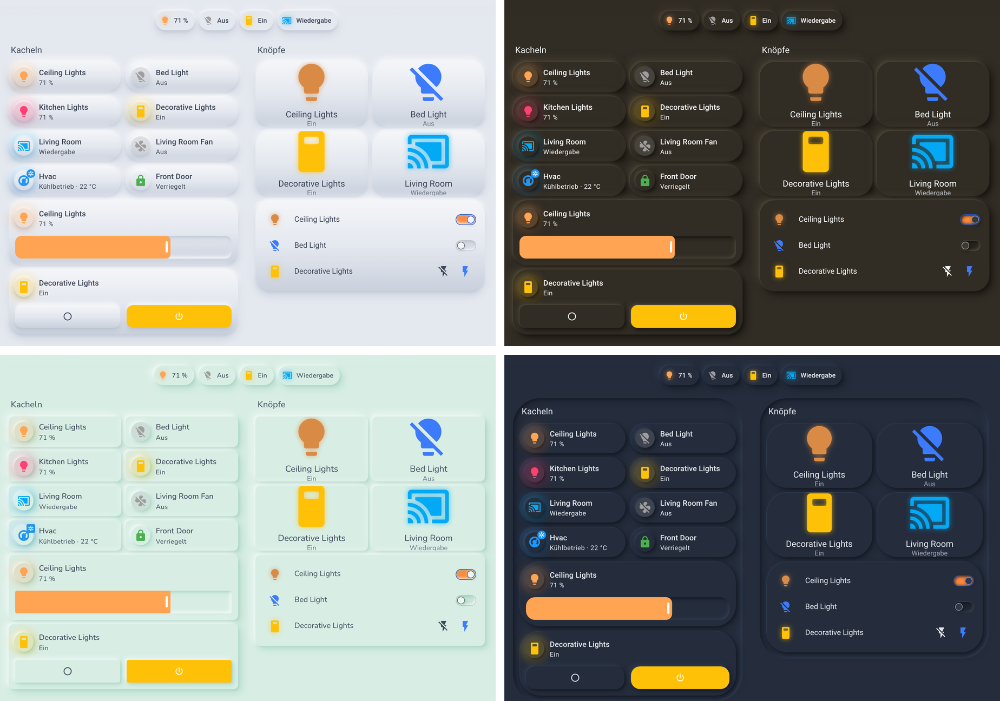
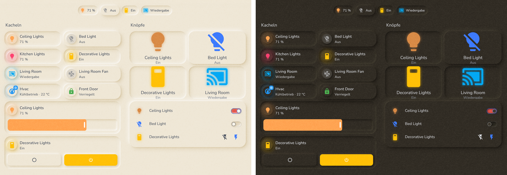
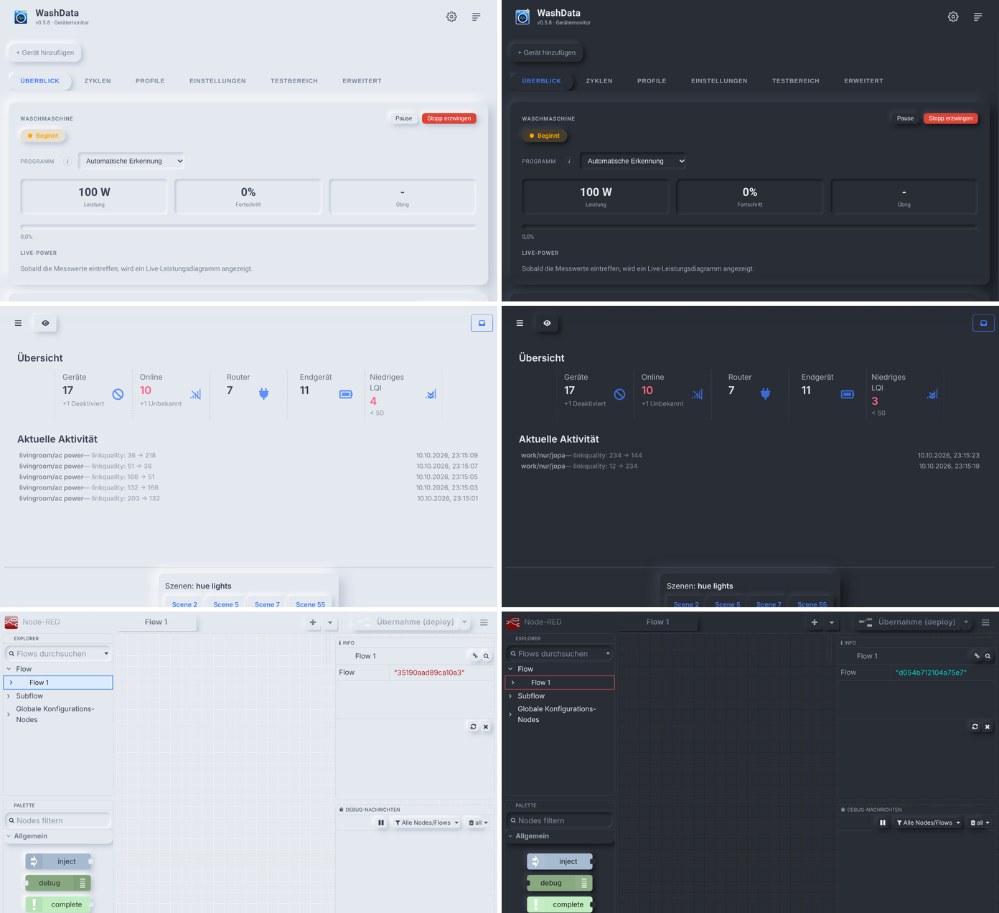

# Neumorphism für Home Assistant

Ein weiches „Soft UI“-Design für Home Assistant, bei dem alles aus einem Guss wirkt. Karten und Bedienelemente haben die Farbe des Hintergrunds und entstehen nur durch Licht und Schatten: Knöpfe, Kachel-Symbole und Regler treten erhaben hervor, Schieber, Auswahlleisten, Schalter und Eingabefelder sind eingelassen.

Das Design gilt überall: auf den Dashboards, in allen Seiten von Home Assistant, in HACS und in den Oberflächen der Add-ons.

- **Hell- und Dunkelmodus**, umgeschaltet wie gewohnt im Profil (Auto / Hell / Dunkel)
- **Geformte Bedienelemente** in Kacheln, Karten und Detailansichten: Schalter, Schieber, Modus-Auswahl, Thermostat- und Luftbefeuchter-Regler, +/–-Knöpfe, Buttons, Eingabefelder
- **Titelleiste ohne Kante**: Der Inhalt läuft beim Scrollen weich darunter aus
- **Alle Seiten von Home Assistant**: Einstellungen, Automationen-Editor, Entwicklerwerkzeuge, Verlauf, Kalender, To-do-Listen, Dialoge und Menüs. Der gewählte Reiter ist eine erhabene Pille, Filter-Chips und aufklappbare Abschnitte sind erhaben, Suchfelder und Code-Editoren eingelassen, die gewählte Zeile in Listen und Tabellen ebenfalls
- **Alles andere automatisch**: Seiten von Integrationen (z. B. WashData, Vacuum Agent), HACS und die Oberflächen von Add-ons (z. B. ESPHome, Zigbee2MQTT, Node-RED, File editor) bekommen dasselbe Design, im Dunkelmodus auch dunkel. Ohne Anpassungen für einzelne Integrationen oder Add-ons, deshalb auch für künftige
- **Auch eigene Karten** aus HACS oder selbst geschrieben, etwa [M3 Cards](https://github.com/j0sp0r/m3-cards), Mushroom, Button Card oder Bubble Card: Rahmen, Chips, Symbolfelder, Knöpfe und Schieber-Spuren werden erhaben oder eingelassen
- **Knöpfe wie Tropfen**: Nebeneinanderliegende Knöpfe, in der Titelleiste wie in Karten und Dialogen, laufen in der Mitte zusammen. Die gewählte Ansicht in der Titelleiste läuft beim Wischen wie ein Tropfen in die Knöpfe hinein, die übrigen Ansichten blenden an den Rändern weich aus
- **Aktive Geräte leuchten** sanft in ihrer Zustandsfarbe oder erscheinen **gedrückt wie ein eingerasteter Taster**, **Knöpfe sinken beim Drücken ein**, Schalter und Auswahl gleiten
- **Vorlagen** per Klick, eigene speichern und als Code teilen
- **Alles einstellbar im Profil**: Primär- und Akzentfarbe, Farbton des Hintergrunds, Effektstärke von −100 bis +100 (im negativen Bereich umgekehrt), Lichtrichtung bis hin zum **Licht nach der Sonne**, gewölbte oder gemuldete Oberfläche, Kontrast, **Prägung**, **Körnung**, Rundung, vier Schriften, Schriftgröße, Abstände, Sektionen eingelassen oder herausgehoben, **Diagramme in Themenfarben**
- **Abendmodus**: ab Sonnenuntergang wärmer, flacher oder dunkel
- Einstellungen gelten **pro Benutzer** auf allen Geräten, **nur für ein Gerät** (etwa ein Wandtablet, auch mit festem Hell- oder Dunkelmodus) oder **für ein Dashboard**
- **Standard für alle Benutzer** legt der Administrator fest, **Automationen** können den Stil ändern
- **Statusleiste** von Browser und App in der Hintergrundfarbe
- **Barrierefrei**: Schrift auf jedem Hintergrund mindestens mit Kontrast nach WCAG AA, deutlich sichtbarer Fokus bei Bedienung per Tastatur
- **Sparsam**: Geprüft wird nur, wenn sich etwas ändert; dazu ein **Sparmodus** für schwache Geräte
- Installation über **HACS** mit Versionen und Änderungsprotokoll, ohne Dateien zu kopieren und ohne Einträge in der `configuration.yaml`. Jede Version wird automatisch geprüft, jede Woche auch gegen die neueste Version von Home Assistant



## Installation

1. **HACS** → ⋮ → *Benutzerdefinierte Repositories* → `https://github.com/Ga-Re/HAThemeNeumorphism` mit Typ **„Integration“** hinzufügen.
2. „Neumorphism“ in HACS öffnen und **herunterladen**.
3. Home Assistant **neu starten**.
4. *Einstellungen → Geräte & Dienste → Integration hinzufügen* → **„Neumorphism“** → *Absenden*.
5. **Profil → Design**: das Theme **„Neumorphism“** wählen.

Ohne HACS: den Ordner `custom_components/neumorphism` nach `/config/custom_components/neumorphism` kopieren und mit Schritt 3 weitermachen.

Updates kommen über HACS, mit Versionsnummer und Änderungen (siehe [CHANGELOG](CHANGELOG.md)). Nach einem Update lädt Home Assistant automatisch die neue Fassung, auch in der Companion-App.

## Einstellungen



Sobald im Profil das Theme „Neumorphism“ gewählt ist, erscheinen im Bereich „Design“ unter dem Design-Modus alle Einstellungen. Änderungen sind sofort zu sehen, Farben und Regler schon während des Ziehens.

Die Einstellungen sind in Gruppen geordnet, die sich auf- und zuklappen lassen. Jede Gruppe zeigt in ihrer Kopfzeile die aktuellen Werte, so bleibt der Überblick auch zugeklappt. Welche Gruppen offen sind, merkt sich das Gerät.

**Vorschau an jeder Einstellung**: Jede Auswahl zeigt im Kleinen, was sie bewirkt, noch bevor du sie wählst. Bei der Lichtrichtung siehst du, wo das Licht steht und wohin der Schatten fällt, bei der Oberfläche die Wölbung, bei der Schrift die Schrift selbst, bei *Zustand als Tiefe* eine eingeschaltete Lampe gedrückt, bei den Animationen einen Knopf, der einsinkt, beim Leuchten eine leuchtende Lampe, bei den Sektionen Mulde oder Platte, bei den Diagrammen die Farben und beim Abendmodus vorher und nachher. Die Regler für Effektstärke, Rundung und Schriftgröße zeigen den aktuellen Wert schon während des Ziehens an einem Beispiel. Die Muster passen sich Licht, Effektstärke und Kontrast an, die gerade eingestellt sind. **Abend ansehen** beim Abendmodus zeigt den Abend sofort auf der ganzen Seite, solange es gedrückt ist. Beim Bearbeiten eines Dashboards zeigt die Seite dessen Stil.

Auswahl und Regler zeigen immer, was gespeichert ist. Liegt gerade etwas darüber, etwa der Abendmodus oder der eigene Stil des Dashboards, auf dem die Einstellungskarte liegt, nennt ein Hinweis oben, was überlagert ist.

**Vorlagen**
- Fertige Stile per Klick: *Klassisch*, *Warm & weich*, *Kontrastreich*, *Flach & modern*, *Mint* und *Papier*. Sie stellen das Aussehen auf einmal ein, Bereiche und Abendmodus bleiben. Danach lässt sich alles weiter anpassen
- **Als Vorlage speichern** legt das aktuelle Aussehen unter einem Namen ab, auf allen Geräten deines Benutzers
- **Code kopieren** und **Code einfügen** übertragen ein Aussehen zu einem anderen Benutzer, einer anderen Installation oder in die Community. Der Code beginnt mit `NEUMORPHISM-1:`

**Farben**
- **Primärfarbe**: Buttons, Symbole, ausgewählte Einträge, Fortschrittsbalken
- **Akzentfarbe**: Schalter, Checkboxen, Hervorhebungen
- **Hintergrund**: Farbton aller Flächen, *Standard* (kühles Grau), *Grau*, *Warm*, *Sand*, *Mint*, *Rosé*, *Blau* oder passend zur *Primärfarbe*. Hell und dunkel jeweils in der passenden Helligkeit Mit *Eigene* wählst du jede Farbe selbst: Im hellen Modus wird der Hintergrund genau diese Farbe (sehr dunkle oder sehr helle Farben werden so weit angepasst, dass die Schatten noch wirken), im dunklen Modus ein dunkler Ton im selben Farbton. Schatten, Mulden und Schieber passen sich mit an
- **Diagramme**: *Themenfarben* färbt Verlauf, Statistik und andere Diagramme passend zu Primär- und Akzentfarbe und lässt ihre Fläche ein; *Wie Home Assistant* lässt sie unverändert

Zu jeder Farbe gibt es einen Farbwähler und zehn Vorgaben zum Antippen.

**Licht und Tiefe**
- **Effektstärke**: von −100 bis +100. +50 ist der Standard, +100 besonders kräftig, 0 flach ohne Schatten. Negative Werte kehren den Effekt um: Karten, Knöpfe und Symbole werden eingelassen, Schieber, Auswahlleisten und Eingabefelder erhaben. Je weiter ins Negativ, desto kräftiger
- **Lichtrichtung**: *Oben links*, *Oben*, *Oben rechts* oder *Sonne*. Die Schatten liegen auf der Gegenseite. Mit *Sonne* wandert das Licht mit dem Sonnenstand aus Home Assistant: morgens von links, mittags von oben, abends von rechts, nachts von oben
- **Oberfläche**: erhabene Flächen *flach*, *gewölbt* wie ein Kissen oder *gemuldet* wie eine Schale
- **Kontrast**: *Hoch* macht Schrift, Linien und Schatten kräftiger und legt eine feine Kante um jede Fläche, für helle Umgebungen oder bessere Lesbarkeit
- **Zustand als Tiefe**: Eingeschaltete Geräte erscheinen gedrückt wie ein eingerasteter Taster, ausgeschaltete erhaben, in Kacheln, Schaltflächen und Abzeichen
- **Prägung**: Überschriften und große Symbole wirken ins Material geprägt
- **Körnung**: *Fein* oder *Kräftig* legt eine feine Struktur wie Papier oder Stoff über alle Flächen

**Form und Schrift**
- **Rundung**: 0 % (eckig) bis 200 % der üblichen Rundung von Karten, Dialogen, Knöpfen und Feldern
- **Schriftgröße**: 85 % bis 130 %
- **Schrift**: *Standard*, *Rund* (Nunito), *Modern* (Inter) oder *Gut lesbar* (Atkinson Hyperlegible). Die Schriften liegen der Integration bei, nichts wird aus dem Internet geladen
- **Abstände**: *Kompakt* passt mehr auf kleine Bildschirme, *Luftig* wirkt ruhiger auf großen
- **Sektionen**: in Dashboards mit Sektionen *Frei* wie gewohnt, *Eingelassen* (die Karten jeder Sektion liegen in einer Mulde) oder *Herausgehoben* (die Karten liegen auf einer erhabenen Platte)

**Bewegung**
- **Animationen**: Knöpfe und Kacheln sinken beim Drücken ein, Schalter und Auswahl gleiten, die gewählte Ansicht erscheint weich. Ist im System „Bewegung reduzieren“ eingeschaltet, bleibt alles still
- **Leuchten aktiver Geräte**: Eingeschaltete Geräte leuchten sanft in ihrer Zustandsfarbe, in Kacheln, Schaltflächen, Abzeichen, Listen und an Schaltern

**Abendmodus**
- Zwischen Sonnenuntergang und Sonnenaufgang *wärmer* (Hintergrund Warm), *flacher* (halbe Effektstärke) und/oder *dunkel* (Dunkelmodus), beliebig kombiniert. Nichts gewählt heißt aus. Braucht die Integration „Sonne“, die in Home Assistant üblicherweise eingerichtet ist

**Bereiche**
- **Eigene Karten**: *Vollständig*, *Nur Rahmen* oder *Aus* (siehe unten)
- **Add-ons und Integrationen**: *Angepasst* oder *Aus*, einzelne lassen sich abwählen (siehe unten)

**Zurücksetzen** stellt alle Einstellungen auf den Standard zurück.





### Für meinen Benutzer, nur für dieses Gerät oder für ein Dashboard

Oben in den Einstellungen wählst du, wofür gespeichert wird:

- **Meinen Benutzer**: gilt auf allen Geräten, auf denen du angemeldet bist. Andere Benutzer stellen ihre eigenen Einstellungen ein.
- **Nur dieses Gerät**: gilt nur in diesem Browser oder dieser App, zum Beispiel für ein Wandtablet, das mit demselben Benutzer angemeldet ist. Es beginnt mit den Einstellungen deines Benutzers. Zurück auf *Meinen Benutzer* gilt wieder alles vom Benutzer.
- **Ein Dashboard** (nur Administratoren): Das gewählte Dashboard bekommt einen eigenen Stil für alle, die es öffnen, etwa das Wandtablet-Dashboard in Sand mit großer Rundung. Es gelten nur die Werte, die du dort änderst; sie gehen auf diesem Dashboard den Einstellungen von Benutzern und Geräten vor. *Zurücksetzen* entfernt den eigenen Stil wieder. Bequem geht das auch mit der Dashboard-Karte (siehe unten) direkt auf dem Dashboard.

Unter **Dieses Gerät** gibt es außerdem:

- **Ausnahme für hell oder dunkel**: Hell oder dunkel stellst du im Profil beim *Design-Modus* von Home Assistant ein (Auto, Hell, Dunkel); das gilt für deinen Benutzer auf allen Geräten, eine zweite Einstellung brauchst du dafür nicht. Nur wenn ein einzelnes Gerät abweichen soll, etwa ein Wandtablet mit demselben Benutzer, das immer dunkel bleibt, wählst du hier *Immer hell* oder *Immer dunkel*. *Keine* folgt dem Design-Modus. Die Ausnahme gilt nur, solange das Neumorphism-Theme gewählt ist
- **Sparmodus**: für schwache Geräte. Ohne Tropfenformen, Animationen und weichgezeichneten Hintergrund hinter Dialogen; Add-ons bleiben unverändert, eigene Karten bekommen nur den Rahmen

### Standard für alle Benutzer

Administratoren sehen unten in den Einstellungen **Als Standard für alle**: Die aktuellen Einstellungen gelten dann für alle Benutzer, die sie nicht selbst ändern. Wer im Profil etwas einstellt, behält seine Wahl; *Zurücksetzen* kehrt zum Standard zurück.

Der Standard lässt sich auch unter *Einstellungen → Geräte & Dienste → Neumorphism → Konfigurieren* bearbeiten. Leere Felder bedeuten dort den Standard des Themes.

### Steuerung per Automation

Mit der Aktion **`neumorphism.set_style`** ändern Automationen und Skripte den Stil für alle Benutzer und Geräte, zum Beispiel abends wärmer und flacher:

```yaml
actions:
  - action: neumorphism.set_style
    data:
      background: warm
      strength: 25
      glow: true
```

Möglich sind `primary_color` und `accent_color` (Farbwähler oder `"#rrggbb"`), `background` (`standard`, `gray`, `warm`, `sand`, `mint`, `rose`, `blue`, `primary`), `strength` (−100 bis 100), `light_direction` (`top_left`, `top`, `top_right`, `sun`), `surface` (`flat`, `convex`, `concave`), `contrast` (`normal`, `high`), `roundness` (0 bis 200), `font` (`standard`, `round`, `modern`, `legible`), `font_size` (85 bis 130), `density` (`compact`, `normal`, `airy`), `sections` (`open`, `well`, `raised`), `pressed`, `emboss`, `animations` und `glow` (`true`/`false`), `grain` (`off`, `fine`, `strong`), `charts` (`theme`, `standard`), `evening` (Liste aus `warm`, `flat`, `dark`), `custom_cards` (`full`, `frame`, `off`) und `addons` (`full`, `off`). Nicht angegebene Einstellungen bleiben, wie sie sind.

Die Vorgaben gelten, auch über einen Neustart hinweg, bis **`neumorphism.reset_style`** sie aufhebt, ganz oder nur einzelne:

```yaml
actions:
  - action: neumorphism.reset_style
    data:
      settings: [background, strength]   # ohne settings: alle
```

Solange eine Automation etwas festlegt, steht das oben in den Einstellungen; Administratoren können es dort auch aufheben.

### Eigene Karten

Karten, die nicht von Home Assistant selbst stammen, bringen ihre eigenen Bausteine mit. Damit auch sie aus einem Guss wirken, werden sie nach Farbe und Form eingeordnet:

- **Rahmen**: Die Karte selbst oder ein innerer Rahmen, der sie ausfüllt, wird erhaben, ohne Rand und ohne Glas-Effekt. Durchsichtige Karten (z. B. reine Überschriften) bleiben unverändert. Karten in einer Karte bekommen keinen zweiten Rahmen.
- **Neutrale oder leicht getönte Flächen** (Chips, Symbolfelder, Knöpfe, Kacheln) werden erhaben in der Kartenfarbe, ihr Inhalt behält seine Farbe.
- **Kräftig gefärbte Flächen** (z. B. ein aktiver Modus) behalten ihre Farbe und werden erhaben.
- **Flächen in Flächen und schmale Spuren** (Schieber, Fortschrittsbalken) werden eingelassen.
- Bilder, Verläufe, Diagramme, Overlays und die Bausteine von Home Assistant bleiben unberührt.

Getestet mit M3 Cards, Mushroom, Button Card und Bubble Card. Weil die Einordnung allgemein arbeitet, kann sie bei einzelnen Karten danebenliegen. Dann im Profil **Eigene Karten** auf *Nur Rahmen* oder *Aus* stellen.

### Add-ons, Integrationen und alles andere

Alles, was nicht von Home Assistant selbst stammt, wird automatisch erkannt und bekommt dasselbe Design. Dazu gehören Seiten und Dialoge von Integrationen aus HACS, die Oberflächen von Add-ons und Webseiten-Karten, deren Seite von Home Assistant selbst kommt. Erkannt wird ein fremder Baustein daran, woher sein Code geladen wird, nicht an seinem Namen. So greift das Design auch bei Integrationen und Add-ons, die es heute noch nicht gibt, ohne dass für sie etwas angepasst werden muss.

- **Formen**: Karten, Dialoge, Menüs und Knöpfe werden erhaben, der gewählte Reiter ebenfalls. Eingabefelder, Code-Editoren und gewählte Einträge sind eingelassen, Leisten und große Flächen bleiben flach.
- **Farben**: Hintergründe, Schrift und Linien bekommen die Farben des Themes, die Primärfarbe gilt auch dort. Kräftig gefärbte Flächen, Bilder und Grafiken bleiben, wie sie sind.
- **Hell und Dunkel**: Hat ein Add-on selbst einen Dunkelmodus, wird er passend zu Home Assistant eingeschaltet. Den Schalter dafür findet das Design selbst in der Oberfläche des Add-ons. Die Einstellungen des Add-ons bleiben dabei unverändert. Helle Code-Editoren werden im Dunkelmodus abgedunkelt.



Sieht etwas damit nicht gut aus, kannst du es im Profil unter **Add-ons und Integrationen** abwählen, es behält dann sein eigenes Aussehen. Die Liste zum Abwählen sehen nur Administratoren. *Aus* schaltet die Anpassung für alle ab.

**Symbole in HACS**: HACS holt die Symbole der Integrationen aus der zentralen Sammlung von Home Assistant. Dort kommen keine eigenen Integrationen mehr hinzu, sie bringen ihr Symbol seit Home Assistant 2026.3 selbst mit. Deshalb lädt HACS die Symbole hier über Home Assistant, ebenso die Update-Liste in den Einstellungen. So erscheinen sie für alle installierten Integrationen, die eines mitbringen, auch für Neumorphism. Mit Home Assistant vor 2026.3 bleibt es beim Platzhalter.

### Als Dashboard-Karte

Dieselben Einstellungen gibt es als Karte für ein Dashboard, praktisch etwa auf einem Wandtablet. Beim Bearbeiten des Dashboards unter „Karte hinzufügen“ nach **„Neumorphism Farben“** suchen, oder per YAML:

```yaml
type: custom:neumorphism-color-card
title: Design   # optional
```

## Problemlösung

**Die Einstellungen erscheinen nicht im Profil**
1. Ist unter „Design“ das Theme **„Neumorphism“** gewählt? Bei „Standard-Design verwenden“ zeigt Home Assistant nur seine eigenen Farbwähler.
2. Ist die Integration eingerichtet? Unter *Einstellungen → Geräte & Dienste* muss „Neumorphism“ stehen. Nur herunterladen reicht nicht.
3. Companion-App: *Einstellungen → Companion-App → Fehlerbehebung → Frontend-Cache zurücksetzen*. Browser: einmal hart neu laden (Strg/Cmd + Shift + R).

**Das Theme „Neumorphism“ fehlt in der Auswahl**: Die Integration ist nicht eingerichtet oder Home Assistant wurde nach dem Herunterladen nicht neu gestartet.

**Ein Add-on oder die Seite einer Integration sieht nicht richtig aus**: Im Profil unter *Add-ons und Integrationen* abwählen, es behält dann sein eigenes Aussehen. Öffnet sich ein Add-on in einem neuen Tab oder über einen eigenen Port, ist es für das Design nicht erreichbar.

**Eine Einstellung lässt sich nicht ändern**: Steht oben in den Einstellungen „Von einer Automation festgelegt“, gilt die Vorgabe der Automation, bis `neumorphism.reset_style` sie aufhebt. Ist *Nur dieses Gerät* gewählt, landen Änderungen nur auf diesem Gerät.

**Ein Gerät reagiert träge**: Unter *Dieses Gerät* den **Sparmodus** einschalten.

**Fehler melden**: *Einstellungen → Geräte & Dienste → Neumorphism → ⋮ → Diagnose herunterladen* und die Datei an das [Issue](https://github.com/Ga-Re/HAThemeNeumorphism/issues) hängen. Sie enthält Version, Einstellungen und kurze Berichte der Geräte, die Home Assistant zuletzt geöffnet haben (Browser, erkannte eigene Karten und Add-ons, letzte Fehlermeldungen), aber keine Namen oder Passwörter.

## Für eigene Karten

Das Theme stellt Schatten-Variablen bereit, die zu Modus und Effektstärke passen, auch zur umgekehrten:

| Variable | Wirkung |
|---|---|
| `--neumorphism-raised-shadow` | erhaben, für Knöpfe und kleine Flächen |
| `--neumorphism-raised-shadow-l` | stärker erhaben, für große runde Knöpfe |
| `--neumorphism-inset-shadow` | eingelassen, für Spuren und Leisten |
| `--neumorphism-inset-shadow-s` | leicht eingelassen, für Eingabefelder |
| `--neumorphism-inset-shadow-l` | tief eingelassen, für große Mulden |
| `--neumorphism-surface-image` | Wölbung erhabener Flächen als `background-image` (bei *Flach* nicht gesetzt) |

Alle folgen auch Lichtrichtung, Hintergrund-Farbton und Kontrast.

Zum Beispiel mit card-mod:

```yaml
card_mod:
  style: |
    ha-card { box-shadow: var(--neumorphism-inset-shadow); }
```

## Theme anpassen

Die Theme-Datei `custom_components/neumorphism/theme/neumorphism.yaml` wird mit `generate.py` erzeugt. Hintergrund, Schatten, Textfarben und Rundungen stehen oben in `generate.py` (`MODES`, `CARD_RADIUS`, `DIALOG_RADIUS`, `HA_RADII`). Nach einer Änderung `python3 generate.py` ausführen (Python 3, keine Zusatzpakete) und die Integration neu laden. Ein HACS-Update überschreibt eigene Änderungen.

## Grenzen

- Eigene Karten und Add-ons werden nach Farbe und Form eingeordnet, nicht nach ihrer Bedeutung. Grafiken, die eine Karte oder ein Add-on selbst zeichnet (z. B. gewellte Schieber, Diagramme), bleiben unverändert.
- Nicht erreichbar sind Seiten auf einer anderen Adresse: Add-ons, die sich in einem neuen Tab oder über einen eigenen Port öffnen, und Webseiten anderer Geräte. Das verhindert der Browser. Ebenso nicht die Anmeldeseite und die eigenen Einstellungsseiten der Companion-App.
- Neumorphism hat von Natur aus wenig Kontrast zwischen Karte und Hintergrund. Auf sehr hellen oder sehr dunklen Displays sind die Kartenränder schwächer zu sehen; dann hilft **Kontrast: Hoch**.
- Leuchten, Zustand als Tiefe und Animationen kennen nur die Bausteine von Home Assistant (Kacheln, Schaltflächen, Abzeichen, Listen, Schalter), nicht die von eigenen Karten.
- Die Körnung liegt über der Seite, Dialoge liegen darüber und bleiben glatt.
- Für das Theme, die Einstellungen im Profil und das Formen der Bedienelemente greift die Integration auf interne Teile des Home-Assistant-Frontends, von HACS und der Add-ons zu, für die es keine offizielle Schnittstelle gibt. Nach größeren Updates von Home Assistant, HACS oder einem Add-on kann eine Anpassung nötig sein; ein automatischer Test gegen die jeweils neueste Version von Home Assistant läuft deshalb jede Woche. Getestet mit Home Assistant 2026.10, HACS 2.0.5, WashData 0.5.8, Vacuum Agent 2.2.5 und den Oberflächen von ESPHome Device Builder 1.23, Zigbee2MQTT 2.14 (Windfront), Node-RED 5.0 und File editor (HASS Configurator 0.6).

## Lizenz

[MIT](LICENSE)
